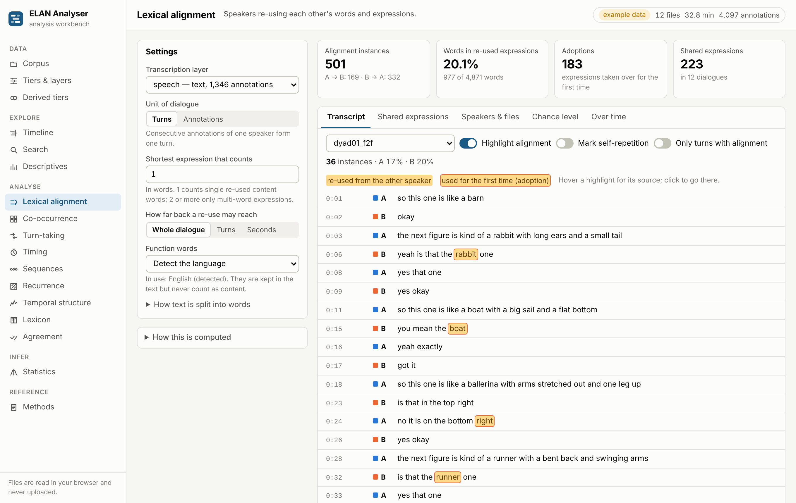
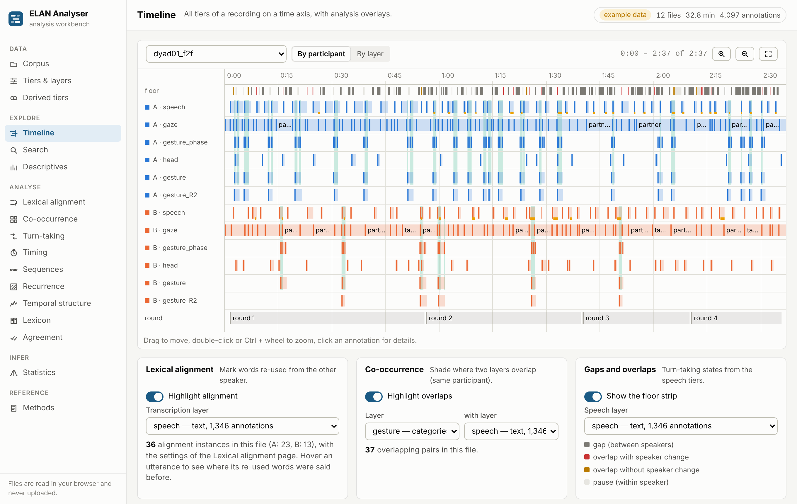
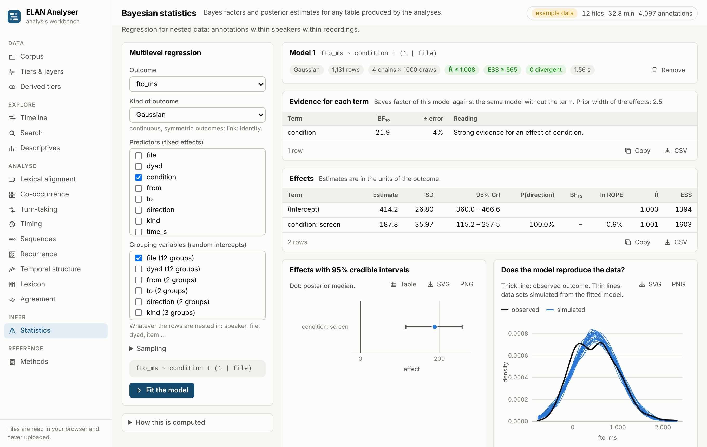
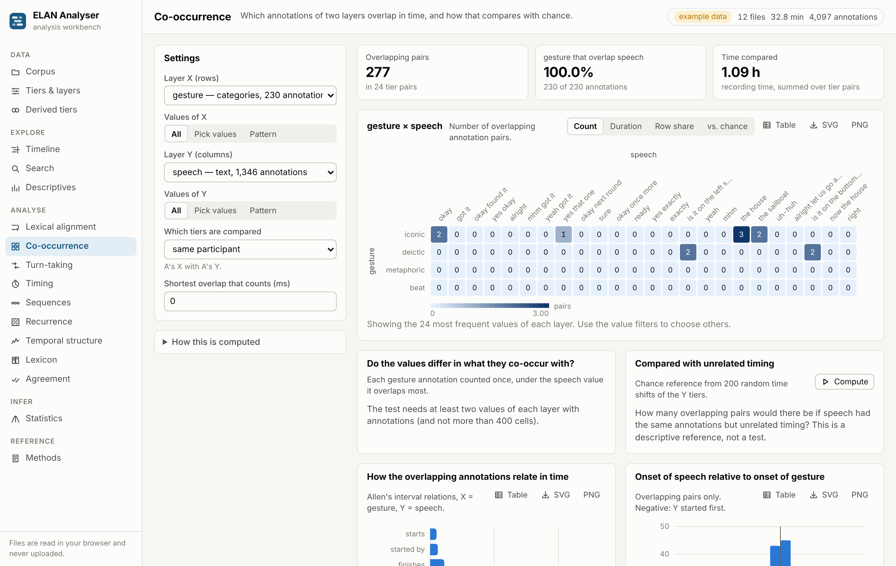
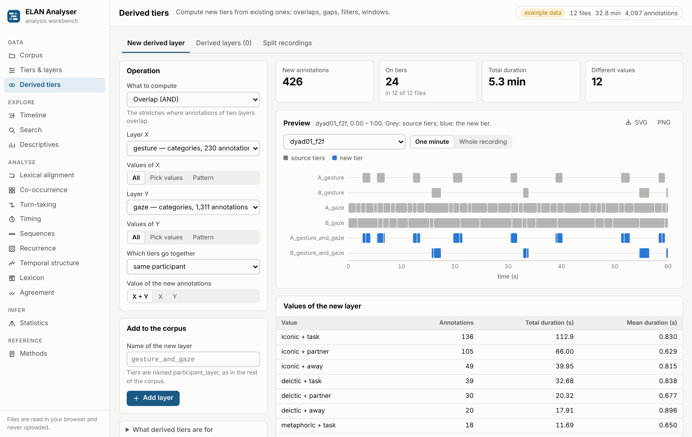
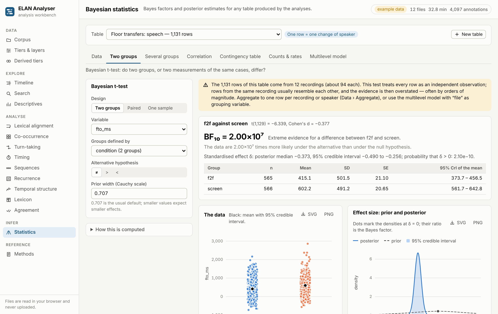

# ELAN Analyser

A graphical analysis workbench for [ELAN](https://archive.mpi.nl/tla/elan) annotation files (`.eaf`): explore time-aligned annotations of speech, gesture and gaze across a whole corpus, and test what you find with Bayesian statistics — without writing a script.

It runs in the browser. Files are read on your computer and are never uploaded; there is nothing to install, and the built program is a single HTML file that also works offline.



## What it does

| | |
|---|---|
| **Corpus** | Load any number of `.eaf` files. Tiers that hold the same kind of annotation for different participants are grouped into *layers* automatically (`A_gesture`, `gesture@B` …), so one setting analyses the whole corpus. File variables such as condition or dyad travel with every result. |
| **Timeline** | All tiers on a time axis, with overlays that can be switched on and off: words re-used from the other speaker, overlap of two layers, gaps and overlaps between speakers. |
| **Lexical alignment** | Highlights every expression a speaker took over from the partner, counts them per speaker and recording, lists the shared expressions, compares with shuffled and fake-pair dialogues, and shows the course over time. |
| **Co-occurrence** | Which values of two layers overlap, how often and for how long — against the chance level from time-shifted surrogates — and how the overlapping annotations relate in time. |
| **Turn-taking, timing, sequences** | Floor transfer offsets, gaps, pauses and overlaps; event lags and states around events; transition probabilities, recurring sequences and Markov order. |
| **Recurrence, temporal structure** | Cross-recurrence with leader–follower asymmetry; burstiness, clustering across time scales, change points in the rate. |
| **Lexicon, agreement, descriptives, search** | Frequencies, dispersion, lexical diversity, key words, concordance; inter-annotator agreement with a posterior for κ; rates and durations; search by text, duration and overlap. |
| **Derived tiers** | Tier algebra: overlap, with / without, merge, gaps, filter, recode, windows, words, turn-taking states, alignment instances. Derived tiers can be analysed like any other and exported as `.eaf`. |
| **Statistics** | A statistics lab for every result table: Bayesian t-test, ANOVA, correlation, contingency tables, rate and proportion tests, and multilevel regression (seven outcome families, random intercepts) sampled with NUTS. Only Bayesian inference: Bayes factors, posteriors and credible intervals — no p-values. |

Every table can be sent to the statistics lab with one click; rows of a table can be linked back to the tiers ("what was the previous speaker's gaze at each change of speaker?"), which turns questions across modalities into an ordinary regression.





<details>
<summary>More screenshots: co-occurrence, derived tiers, a Bayesian t-test</summary>







</details>

## Try it

The program opens with an invented example corpus (12 dyads in a referential communication task, [described here](docs/DEMO_CORPUS.md)), so every view shows something right away. Load your own files by dropping them anywhere on the page.

```bash
npm install
```

```bash
npm run dev
```

Then open the address that is printed (usually http://localhost:5173).

To build the program for distribution:

```bash
npm run build
```

This writes `dist/elan-analyser.html`, a single self-contained file of about 0.8 MB. Open it from disk, send it to colleagues or put it on a web server — it needs no network access. (`dist/index.html` with the `assets` folder is the same program for hosting.)

Node.js 22 or newer is needed for development; using the built file needs only a current browser.

## What to use it for

[docs/METHODS.md](docs/METHODS.md) lists, with references:

- **questions from the literature** and where each analysis is found in the program — lexical and gestural alignment, turn-timing, gesture–speech timing, gaze at turn ends, co-occurrence, sequential analysis, cross-recurrence, burstiness, key words, inter-annotator agreement;
- **questions that become possible** once tiers, tables and models are connected — for example whether a turn is taken faster when the previous speaker was gesturing, whether alignment happens under mutual gaze, or whether speech, gesture and gaze change together over the rounds of a task — each as a short recipe;
- **how every analysis computes its numbers**, and how the statistics were validated.

The same text is on the **Methods** page inside the program.

## Statistics, and how far to trust them

All statistical methods are implemented in this repository (TypeScript, no server) and tested against independent implementations:

| Component | Checked against |
|---|---|
| Special functions and distributions | SciPy and mpmath at high precision |
| t-test, ANOVA, correlation and contingency-table Bayes factors | R package BayesFactor |
| Multilevel models (NUTS sampler) | Stan via rstanarm: posterior means, standard deviations and quantiles |
| Marginal likelihoods (bridge sampling) | exact numerical integration, including a multilevel model |

The scripts that produced the reference values are in [`tests/reference`](tests/reference), the values in [`tests/fixtures`](tests/fixtures).

```bash
npm test
```

runs about 170 tests in roughly 15 seconds.

Things to keep in mind:

- The simple tests assume independent rows. Annotations of one speaker or recording are not independent: aggregate first (Statistics › Data › Aggregate) or use the multilevel model. The program warns when the rows of a table come from few recordings — in the example corpus the pooled t-test on 1,131 changes of speaker reports a Bayes factor of 2 × 10⁷ for the effect of condition, the multilevel model with the twelve recordings as groups about 20.
- Bayes factors depend on the prior. Every test shows how the result changes with the prior width; report the prior with the result.
- In multilevel models the evidence for a term comes from comparing the models with and without it. A Bayes factor for a single coefficient is shown only where it can be estimated from the posterior draws and is never extrapolated.
- This is research software without a formal audit. For results that matter, check the key analysis with a second tool; all tables export as CSV.

## Limits

- Reads `.eaf` (ELAN 2.7 to 3.0 formats). Other formats such as Praat TextGrid are not read yet.
- Works on annotations only: media files are not opened or played.
- Multilevel models have random intercepts, not random slopes, and at most one interaction.
- Nothing is saved between sessions: settings, derived tiers and tables live until the page is reloaded. Export what you want to keep (CSV, SVG/PNG, `.eaf` for derived tiers).
- Everything runs in the browser's memory. Corpora with tens of thousands of annotations are comfortable; very large ones will be slow.

## For developers

```
src/core/eaf        EAF parser and writer
src/core/corpus     corpus model: files, layers, participants
src/core/analysis   one module per analysis (alignment, co-occurrence, turn-taking …)
src/core/stats      special functions, Bayesian tests, NUTS sampler, multilevel models
src/core/data       tables that connect the analyses with the statistics lab
src/reference       text and bibliography of the Methods page and docs/METHODS.md
src/ui              React interface: views, charts, statistics panels
tests               unit tests, reference values and the scripts that produced them
```

The core has no dependency on the interface and can be used on its own.

| Command | |
|---|---|
| `npm run dev` | development server |
| `npm test` | tests |
| `npm run typecheck` | type check |
| `npm run build` | production build and the single-file version |
| `npm run docs` | regenerate `docs/METHODS.md` from `src/reference` |
| `npm run demo:write` | write the example corpus to `examples/demo-corpus` |

## Licence and acknowledgement

MIT, see [LICENSE](LICENSE).

ELAN is developed by the Max Planck Institute for Psycholinguistics, The Language Archive, Nijmegen. ELAN Analyser is an independent project; it is not affiliated with or endorsed by the institute. It only reads the file format.
